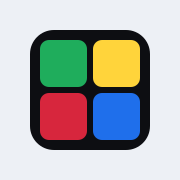
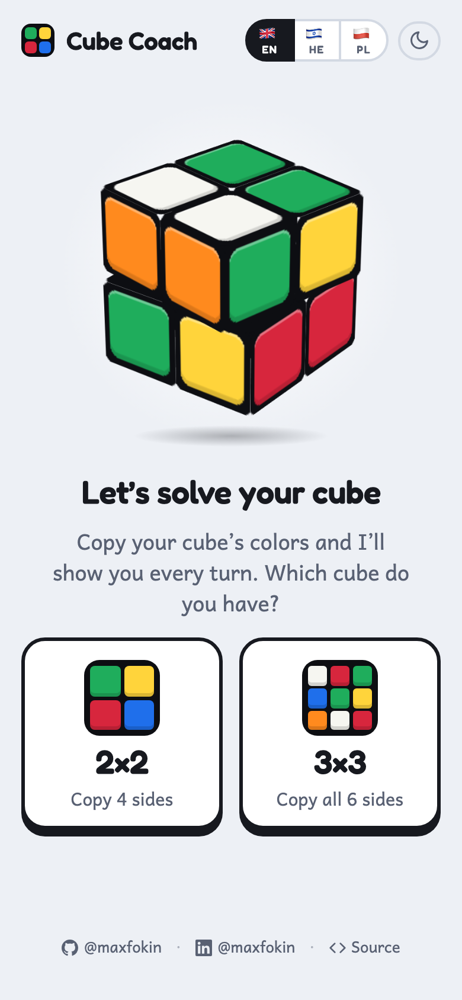
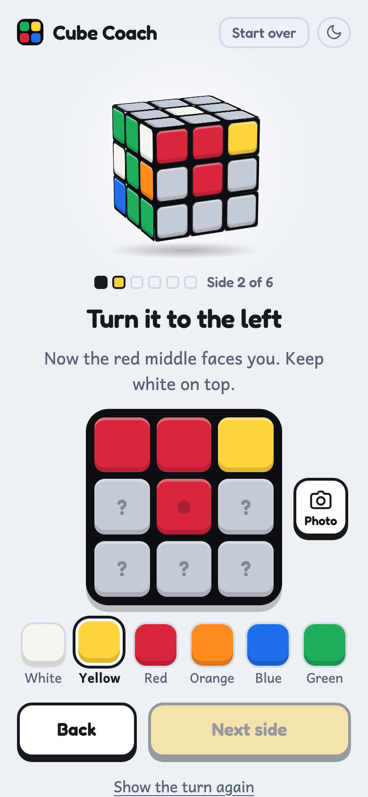
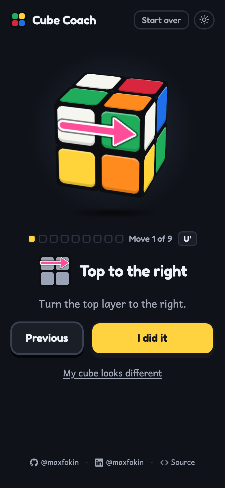

<p align="center">
  
</p>

<h1 align="center">Cube Coach</h1>

<p align="center">
  A friendly web app that walks a child through solving a 2×2 or 3×3 Rubik's cube, one turn at a time.<br>
  <a href="https://maxfokin.github.io/cube-coach/"><strong>Open the app →</strong></a>
</p>

<p align="center">
  
  
  
</p>

## How it works

1. **Copy the cube.** Tap the colors of each side, or point the camera at it and let the app read them.
2. **Let it check.** The app makes sure the copy is a real cube, points at a wrong square, and quietly
   fixes a side that was copied turned around.
3. **Follow the turns.** Every turn is shown flat, on the side the child is looking at: the layer
   slides the way the arrow points, a small picture shows the side after the turn, and the words say
   it like a coach. Progress is saved on the phone, so a closed browser picks up at the same turn.

## Features

- 🧩 **2×2 and 3×3.** The 2×2 gets an optimal solution (at most 11 turns), the 3×3 a short one from
  the cubejs solver (about 20 turns).
- 📷 **Camera copying** with live color dots, or a photo from the gallery with drag and pinch.
- 🌍 **English, Hebrew and Polish.** It opens in the phone's language, and a switch on the first screen
  overrides it. Hebrew runs right to left while the cube stays put.
- 🌙 **Light and dark**, following the phone until the moon button says otherwise.
- 📱 **Made for one hand on a phone:** big buttons, one action per screen, and it works from the
  home screen.
- 🔒 **Nothing leaves the phone.** Photos are read in the browser and never uploaded; there is no
  server, no account and no tracking.

## Put it on a phone

Open **https://maxfokin.github.io/cube-coach/** in Safari or Chrome, then *Share → Add to Home
Screen*. The live camera needs HTTPS, which GitHub Pages provides. The 3×3 downloads its solver the
first time it is picked and takes a few seconds to warm up; after that it is instant.

## Under the hood

The whole app is one file, `index.html`, built from `src/` by `build.py`: plain HTML, CSS and
JavaScript, no framework, no build step beyond concatenation. The 3D cube on the start, check and hold
screens is pure CSS; the turns are shown flat.

| File | What it does |
|---|---|
| `core2.js` | The 2×2: stickers and moves, the whole cube deduced from four sides, an optimal breadth-first solver |
| `core3.js` | The 3×3 in Kociemba facelet order: validation, turned-side and wrong-square search |
| `flat.js` | Which side a turn is shown on, which row or column moves and which way |
| `colorread.js` | Reads sticker colors from camera frames and photos, and finds the cube in a photo |
| `strings.js` | Every word a person reads, in English, Hebrew and Polish |
| `ui.js` | Screens, state, the flat view of a turn, the CSS 3D cube, language and theme |
| `camera.js` | The camera sheet: live view, photo fallback, drag and pinch |

The 3×3 solver is [cubejs](https://github.com/ldez/cubejs) (MIT), loaded from jsDelivr when a 3×3 is
picked. Fonts are Fredoka, Andika and Assistant from Google Fonts.

## Develop

```bash
npm install          # test dependencies only
python3 build.py     # writes index.html from src/
npm test             # Node tests: strings, 2x2, 3x3 (cross-checked against cubejs), color reading
```

The browser tests run in headless Chromium through Playwright:

```bash
python3 -m venv .venv && .venv/bin/pip install playwright && .venv/bin/playwright install chromium
node tests/e2e/fixtures.js        # a random 3x3 scramble and a fake camera clip
source .venv/bin/activate
npm run e2e                       # a 2x2 solve in every language, a 3x3 solve, the photo and camera paths
npm run screens                   # every screen's English text and height against a snapshot
python3 tests/e2e/screens.py he   # the same walk in Hebrew (or pl)
python3 tests/e2e/screenshots.py  # refreshes the screenshots above
```

Edit `src/`, rebuild, run the tests, and commit `index.html` together with the sources. Every push to
`main` goes live on GitHub Pages within a minute. `CLAUDE.md` holds the full project notes: how the
cube models, the solver, the camera and the translations work, and what the tests guarantee.

## Author

Built by Max Fokin for his son, together with Claude.
[GitHub](https://github.com/maxfokin/) · [LinkedIn](https://www.linkedin.com/in/maxfokin/)
